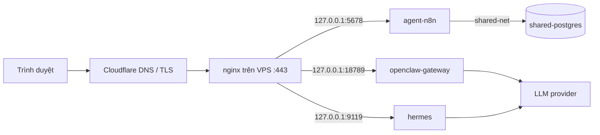

# Agent playground: n8n + OpenClaw + Hermes (Docker)

Ba nền tảng agent chạy độc lập trong cùng một compose project, bật/tắt từng cái bằng Makefile.
Web UI chỉ bind `127.0.0.1`; TLS và domain do nginx native trên VPS đảm nhận, DNS qua Cloudflare.



## Yêu cầu

- Docker Engine + Compose v2 (repo đã dùng sẵn).
- `../infra` đang chạy (`shared-postgres`, network `shared-net`) — n8n dùng Postgres chung.
- nginx native trên host + domain trỏ về VPS (Cloudflare DNS).
- RAM: giới hạn mặc định 2 GB (n8n) + 3 GB (OpenClaw) + 4 GB (Hermes) = 9 GB. VPS 12 GB còn ~3 GB cho infra/monitoring/hệ điều hành.

## Cài đặt lần đầu

```bash
cd agent
make init          # sinh .env với secret ngẫu nhiên, tạo data/, chmod 600
vi .env            # đặt N8N_HOST, OPENCLAW_HOST, HERMES_HOST, N8N_WEBHOOK_URL
make n8n-db        # tạo role + database n8n trong shared-postgres (idempotent)
make openclaw-init # onboarding OpenClaw + cấu hình reverse proxy (interactive)
make hermes-setup  # wizard Hermes: API key, model, channel (interactive)
make up
make ps
```

`make openclaw-init` phải chạy khi gateway **chưa** chạy: onboarding chiếm quyền sở hữu state độc
quyền và một container đang chạy sẽ chặn nó. Nếu lỡ bật gateway trước, dừng bằng `make down-openclaw`,
đợi ~90 giây cho heartbeat ownership hết hạn, rồi chạy lại. Đổi domain/IP sau này thì không cần
onboarding lại: `make openclaw-conf` (chạy được khi gateway đang chạy) rồi để target tự restart.
`make hermes-setup` cũng chạy khi container dừng; cả hai ghi vào `data/` nên chỉ cần chạy một lần.

Nếu bỏ qua `make openclaw-init`, gateway vẫn khởi động (`--allow-unconfigured`) với token trong
`.env`, nhưng chưa có provider/model: mở Control UI để cấu hình hoặc chạy onboarding sau.

n8n không có bước CLI: mở UI lần đầu và tạo owner account.

## Bật / tắt

| Lệnh | Tác dụng |
|---|---|
| `make up` / `make up-all` | bật tất cả |
| `make down` / `make down-all` | tắt + xóa container của tất cả (giữ `data/`) |
| `make up-n8n`, `make up-openclaw`, `make up-hermes` | bật một nền tảng |
| `make down-<svc>` | xóa container của một nền tảng, giữ dữ liệu |
| `make restart`, `make restart-<svc>` | restart |
| `make logs`, `make logs-<svc>` | theo dõi log |
| `make up SVC=hermes` | tương đương `make up-hermes` |
| `make ps`, `make pull`, `make config`, `make urls` | trạng thái / cập nhật image / kiểm tra config / in URL |
| `make openclaw-conf` | áp lại config reverse proxy/token khi gateway đang chạy (đổi domain/IP) |
| `make openclaw-cli CMD="devices list"` | CLI OpenClaw (channels add, devices approve, config get…) |
| `make hermes-cli CMD="doctor"` | CLI Hermes |
| `make shell SVC=n8n` | shell trong container |

`make down` chỉ xóa container; `data/` và network external `shared-net` không bị đụng tới.
`agent-net` do compose tạo nên sẽ bị xóa cùng project và được tạo lại (cùng subnet) ở `make up` kế
tiếp.

## Truy cập qua nginx

Mỗi service nghe trên loopback với port trong `.env` (`N8N_HOST_PORT`, `OPENCLAW_HOST_PORT`,
`HERMES_DASHBOARD_HOST_PORT`, `HERMES_API_HOST_PORT`).

### n8n — `n8n.example.com`

```nginx
server {
    listen 443 ssl http2;
    server_name n8n.example.com;

    # ssl_certificate ...            (xem mục Cloudflare)
    client_max_body_size 64m;

    location / {
        proxy_pass http://127.0.0.1:5678;
        proxy_http_version 1.1;
        proxy_set_header Upgrade $http_upgrade;
        proxy_set_header Connection "upgrade";
        proxy_set_header Host $host;
        proxy_set_header X-Real-IP $remote_addr;
        proxy_set_header X-Forwarded-For $proxy_add_x_forwarded_for;
        proxy_set_header X-Forwarded-Proto $scheme;
        proxy_read_timeout 3600s;   # workflow chạy lâu / SSE
        proxy_send_timeout 3600s;
    }
}
```

### OpenClaw — `claw.example.com`

```nginx
server {
    listen 443 ssl http2;
    server_name claw.example.com;

    location / {
        proxy_pass http://127.0.0.1:18789;
        proxy_http_version 1.1;
        proxy_set_header Upgrade $http_upgrade;
        proxy_set_header Connection "upgrade";
        proxy_set_header Host $host;
        # GHI ĐÈ, không dùng $proxy_add_x_forwarded_for: OpenClaw coi header
        # forwarded là dữ liệu do proxy tạo, không phải do client gửi.
        proxy_set_header X-Forwarded-For $remote_addr;
        proxy_set_header X-Real-IP $remote_addr;
        proxy_set_header X-Forwarded-Proto $scheme;
        proxy_buffering off;        # WebSocket + stream sự kiện
        proxy_read_timeout 3600s;
        proxy_send_timeout 3600s;
    }
}
```

### Hermes — `hermes.example.com`

```nginx
server {
    listen 443 ssl http2;
    server_name hermes.example.com;

    client_max_body_size 64m;      # upload file qua dashboard

    location / {
        proxy_pass http://127.0.0.1:9119;
        proxy_http_version 1.1;
        proxy_set_header Upgrade $http_upgrade;
        proxy_set_header Connection "upgrade";
        proxy_set_header Host $host;
        proxy_set_header X-Real-IP $remote_addr;
        proxy_set_header X-Forwarded-For $proxy_add_x_forwarded_for;
        proxy_set_header X-Forwarded-Proto $scheme;
        proxy_read_timeout 3600s;
    }
}
```

TLS: dùng `certbot --nginx -d <domain>` (Let's Encrypt) hoặc Cloudflare Origin Certificate.
Nếu dùng Cloudflare Origin Certificate, đặt `ssl_certificate`/`ssl_certificate_key` trỏ tới file
Cloudflare cấp và bật **Full (strict)** ở Cloudflare.

### Cloudflare

1. A record `n8n` / `claw` / `hermes` → IP VPS, bật Proxy (đám mây cam).
2. SSL/TLS mode: **Full (strict)**.
3. WebSocket được Cloudflare proxy mặc định; không cần bật gì thêm.
4. **Hop count**: Cloudflare + nginx = 2 proxy trước n8n → giữ `N8N_PROXY_HOPS=2`. Nếu tắt Proxy
   (DNS-only) đổi thành `1`, nếu không n8n sẽ đọc sai IP client và rate limit theo IP Cloudflare.
5. IP client thật: khi Proxy bật, `$remote_addr` trong nginx là IP của Cloudflare edge. Muốn log/rate
   limit đúng IP người dùng, bật `ngx_http_realip_module` với dải IP Cloudflare:

```nginx
# /etc/nginx/conf.d/cloudflare-realip.conf — cập nhật dải IP từ cloudflare.com/ips
set_real_ip_from 173.245.48.0/20;
set_real_ip_from 103.21.244.0/22;
# ... thêm các dải còn lại ...
real_ip_header CF-Connecting-IP;
```

Sau đó vẫn giữ `proxy_set_header X-Forwarded-For $remote_addr` cho OpenClaw (header này lúc đó
mang IP thật), và `$proxy_add_x_forwarded_for` cho n8n/Hermes.

Firewall: chỉ mở 22/80/443. Các port service bind loopback nên không lộ ra ngoài; đừng đổi
`BIND_ADDR=0.0.0.0` khi chưa có firewall ở tầng `DOCKER-USER` (xem cảnh báo bên dưới).

## Cảnh báo và đánh đổi

### Bảo mật

- **Không có service nào được thiết kế để lộ trực tiếp ra Internet.** n8n có user management,
  OpenClaw có token, Hermes có basic auth, nhưng cả ba đều giả định có TLS ở nginx. Luôn proxy qua
  HTTPS, đừng publish port ra `0.0.0.0`.
- **`N8N_ENCRYPTION_KEY`**: mất key này là mất toàn bộ credential đã lưu trong n8n, kể cả khi còn
  database. Backup key cùng lúc với `pg_dump`. `make init` không bao giờ ghi đè `.env` đã tồn tại.
- **`OPENCLAW_GATEWAY_TOKEN`** là quyền operator đầy đủ trên gateway (chat, tools, pairing, cấu
  hình). Nằm trong `.env` (chmod 600) và trong env container. Rotate: sửa `.env`, `make restart-openclaw`,
  cập nhật client. Token ngắn hơn 24 ký tự bị `openclaw security audit` cảnh báo.
- **`gateway.trustedProxies`** của OpenClaw phải là IP mà nginx xuất hiện khi vào container
  (`PROXY_IP=192.168.32.1`, gateway của `AGENT_SUBNET`). Sai/thiếu → mọi request qua nginx nhận
  `403 proxy_attribution_required` và WebSocket không kết nối được. Đổi `AGENT_SUBNET` thì phải đổi
  `PROXY_IP` và chạy lại bước `config set` của `make openclaw-init`.
- **`gateway.controlUi.allowedOrigins`** phải chứa `https://<OPENCLAW_HOST>`; thiếu → Control UI bị
  từ chối origin. `make openclaw-init` ghi giá trị này; đổi domain thì chạy lại.
- **Hermes dashboard** bắt buộc auth provider khi bind non-loopback và **fail-closed** nếu thiếu;
  `HERMES_DASHBOARD_INSECURE` đã bị vô hiệu từ bản hardening 06/2026. Basic auth đủ cho homelab sau
  TLS, **không** đủ nếu lộ port trần ra Internet.
- **Cookie `Secure` của Hermes**: nginx kết thúc TLS nên container chỉ thấy HTTP. Basic auth vẫn
  hoạt động, nhưng muốn cookie `Secure` + `public_url` đúng thì thêm vào
  `data/hermes/config.yaml` sau `make hermes-setup`:

  ```yaml
  dashboard:
    public_url: "https://hermes.example.com"
    trusted_proxies:
      - "192.168.32.1"
  ```

  `trusted_proxies` cố tình chỉ nhận IP cụ thể; Hermes từ chối `*`, `0.0.0.0/0`, `::/0`.
- **API server của Hermes** (OpenAI-compatible, cổng `8642`) **luôn chạy** trong image `v0.23.1`:
  biến `API_SERVER_ENABLED=false` bị bỏ qua, còn `API_SERVER_KEY` được image tự sinh vào
  `data/hermes/.env` ở lần boot đầu tiên (xem bằng `grep API_SERVER_KEY data/hermes/.env`). Port chỉ
  publish ra loopback và **không** có vhost nginx trong repo này, nên chưa lộ ra Internet. Nếu thêm
  vhost cho `8642`, mọi client phải gửi `Authorization: Bearer <key>`; key này là toàn quyền điều
  khiển agent và terminal (chạy không sandbox), nên chỉ mở cho mạng tin cậy. Hermes trong container
  này chạy terminal backend `local` — bật `terminal.backend: docker` nếu muốn cô lập lệnh agent.
- **Capabilities**: OpenClaw chạy với `cap_drop: NET_RAW/NET_ADMIN` + `no-new-privileges`. Không
  mount `/var/run/docker.sock` — nghĩa là sandbox Docker của OpenClaw và terminal backend của Hermes
  không dùng được. Muốn bật phải mount socket, và lúc đó container gần như tương đương root trên host.

### Vận hành

- **Version pin cứng** (`N8N_IMAGE`, `OPENCLAW_IMAGE`, `HERMES_IMAGE` trong `.env`). Không tự động
  cập nhật. `make pull` chỉ kéo tag hiện tại; muốn nâng cấp sửa tag rồi `make up`.
- **OpenClaw: một gateway cho một state volume.** Khi nâng cấp, dừng container cũ trước rồi mới chạy
  bản mới (image chạy `openclaw doctor --fix` cần quyền sở hữu state độc quyền):
  `make down-openclaw && make pull && make up-openclaw`. Không scale replica, không dùng chung
  `data/openclaw` cho hai container.
- **Hermes: một gateway cho một `/opt/data`.** Hai container cùng mount `data/hermes` sẽ làm hỏng
  session/memory. Nhiều profile thì dùng `hermes profile create` trong cùng container, không tạo
  container thứ hai.
- **SQLite/WAL**: `data/hermes/state.db` và `data/openclaw/state/*.sqlite` cần filesystem local hỗ
  trợ shared memory. Bind mount trên ext4/xfs ổn; **không** đặt `data/` trên NFS/SMB/CIFS/virtiofs.
- **Quyền file**: n8n và OpenClaw chạy cứng ở uid/gid 1000. `make init` chown `data/n8n`,
  `data/openclaw`, `data/openclaw-auth-profile-secrets` sang 1000; nếu user deploy không phải uid
  1000, chạy lệnh `sudo chown -R 1000:1000 ...` mà Makefile in ra. Hermes dùng
  `HERMES_UID`/`HERMES_GID` (mặc định 1000) để remap user nội bộ của image; đặt hai biến này bằng
  `id -u` / `id -g` của user sở hữu `data/hermes` để file trên host dễ đọc/backup. Nếu đổi UID sau
  khi đã chạy, phải `chown` lại `data/hermes` (container chown khi khởi động bằng quyền root).
- **Giới hạn RAM** (`*_MEM_LIMIT`) là trần, không phải đặt trước. Nếu cả ba cùng chạy workload nặng
  trên VPS 12 GB, tổng trần 9 GB + infra có thể vượt RAM thật; giảm limit hoặc thêm swap.
- **Không có backup tự động.** Cần backup: `data/n8n` (không bắt buộc nếu đã có Postgres, nhưng giữ
  key), `pg_dump` database `n8n`, `data/openclaw`, `data/openclaw-auth-profile-secrets`,
  `data/hermes`, và `.env` (chứa encryption key + token). Treat `data/openclaw` như credential:
  OAuth token nằm plaintext trong SQLite.
- **Log** xoay vòng 10 MB × 3 file/container. Log của Hermes gateway còn được ghi vào
  `data/hermes/logs/gateways/<profile>/current` (xoay 10 × 1 MB).
- **Không nối Prometheus/Grafana.** Có thể thêm sau: OpenClaw có plugin `diagnostics-prometheus`
  (scrape qua route gateway có auth), Hermes/n8n cần exporter riêng.
- **n8n không có sandbox stack** (sandbox-api + runner privileged DinD). Vì vậy n8n Assistant chạy
  code không hoạt động; task runner internal mode của n8n 2.x đã deprecated và image không có Python.
  Không bật stack đó trên VPS dùng chung: runner là `privileged` và tương đương root host.
- **Cloudflare timeout**: request/webhook chạy quá 100 s có thể bị Cloudflare cắt (lỗi 524) dù n8n
  vẫn chạy. Với webhook dài, dùng DNS-only cho host đó hoặc trả response sớm.
- **`agent-net` dùng subnet cố định `192.168.32.0/24`**. Nếu VPS đã có network khác dùng dải này,
  đổi `AGENT_SUBNET` + `PROXY_IP` (và chạy lại cấu hình proxy của OpenClaw/Hermes).
- **OpenClaw browser tool** cần image `-browser` (Chromium baked in, nặng hơn ~1 GB):
  `OPENCLAW_IMAGE=ghcr.io/openclaw/openclaw:2026.11.3-browser`. Mặc định image thường không có
  Chromium.

## Vận hành thường ngày

```bash
make ps
make logs-hermes
make shell SVC=hermes
make openclaw-cli CMD="channels add --channel telegram --token <token>"
make openclaw-cli CMD="devices list"
make hermes-cli CMD="doctor"
```

Backup tối thiểu:

```bash
cd agent
tar czf backup-agent-$(date +%F).tar.gz .env data/n8n data/openclaw \
    data/openclaw-auth-profile-secrets data/hermes
docker exec shared-postgres pg_dump -U "$(sed -n 's/^POSTGRES_USER=//p' ../infra/.env)" n8n \
  | gzip > n8n-$(date +%F).sql.gz
```

Reset một nền tảng (mất toàn bộ state của nền tảng đó):

```bash
make down-hermes && rm -rf data/hermes && make hermes-setup && make up-hermes
```

## Troubleshooting

| Triệu chứng | Nguyên nhân / cách xử lý |
|---|---|
| OpenClaw trả `403 proxy_attribution_required` | Thiếu `gateway.trustedProxies` hoặc sai IP. Gateway đang chạy: `make openclaw-conf`; chưa cấu hình lần nào: `make down-openclaw`, đợi ~90 s, `make openclaw-init`. Kiểm tra `PROXY_IP` khớp subnet `agent-net`. |
| Control UI OpenClaw báo origin bị từ chối | `gateway.controlUi.allowedOrigins` thiếu `https://<domain>`. Chạy lại `make openclaw-init` sau khi sửa `OPENCLAW_HOST`. |
| `EACCES` trên `/home/node/.openclaw` | Bind mount không thuộc uid 1000. `sudo chown -R 1000:1000 data/openclaw data/openclaw-auth-profile-secrets`, rồi `make restart-openclaw`. |
| n8n báo `password authentication failed` | Chưa chạy `make n8n-db`, hoặc `N8N_DB_PASSWORD` trong `.env` khác mật khẩu role đã tạo. Sửa role bằng `ALTER ROLE`. |
| Hermes dashboard không lên, log báo thiếu auth provider | Thiếu `HERMES_DASHBOARD_BASIC_AUTH_*`; biến rỗng cũng bị coi là thiếu. Kiểm tra `docker compose config`. |
| Webhook n8n sinh URL sai (`:5678` hoặc domain lạ) | `N8N_WEBHOOK_URL` sai/không có. Phải là `https://<domain>/` (có dấu `/` cuối). |
| `make init` báo `.env already exists` | Cố ý không ghi đè vì sẽ mất `N8N_ENCRYPTION_KEY`. Xóa tay nếu thật sự muốn tạo lại. |
| Container n8n restart liên tục, log `ECONNREFUSED shared-postgres` | `../infra` chưa chạy hoặc Postgres chưa healthy: `cd ../infra && make up && make ps`. |
