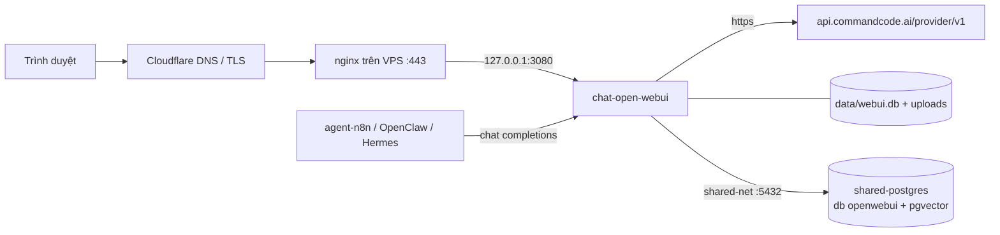

# Chat app: Open WebUI (Docker)

Open WebUI chạy một container, nối tới gateway OpenAI-compatible của Command Code và dùng model
`deepseek/deepseek-v4.1-flash`. Người dùng, hội thoại và cấu hình nằm trong SQLite ở `data/`;
embedding cho RAG nằm trong `shared-postgres` (extension pgvector) của `../infra`.

Web UI chỉ bind `127.0.0.1:3080`; TLS và domain do nginx native trên VPS đảm nhận, DNS qua
Cloudflare — giống `../agent`.

Runbook deploy lần đầu (đổi Postgres sang pgvector → tạo DB → chạy app → nginx):
[DEPLOY.md](DEPLOY.md).



## Yêu cầu

- Docker Engine + Compose v2 (repo đã dùng sẵn), `openssl`, `curl`, `python3`.
- `../infra` đang chạy: `shared-net` và `shared-postgres` (image `pgvector/pgvector:0.8.7-pg17`).
  Thiếu network thì `cd ../infra && make network`; thiếu Postgres thì `cd ../infra && make up`.
- nginx native trên host + domain trỏ về VPS (Cloudflare DNS) nếu muốn truy cập từ ngoài.
- RAM: `mem_limit` mặc định 2 GB, lúc rảnh container chiếm ~0.6–1 GB. Lần khởi động đầu (và mỗi khi
  `data/cache` trống) Open WebUI tải model embedding RAG ~90 MB từ HuggingFace, nên boot mất vài phút;
  sau đó upload tài liệu tốn thêm ~0,5–1 GB RAM. Muốn offline hoàn toàn thì đặt `OFFLINE_MODE=true`,
  đánh đổi là RAG/upload tài liệu không dùng được (log báo `LocalEntryNotFoundError`).
- API key Command Code (`user_...`) — tạo ở https://commandcode.ai/studio (`cmd login` cũng được).
  Key hết hạn thì chat trả 401 dù container vẫn healthy.

## Cài đặt lần đầu

```bash
cd chat-app
make init                      # sinh .env + secret, tạo data/, in mật khẩu admin
vi .env                        # đặt WEBUI_URL, OPENAI_API_KEY
make config                    # kiểm tra compose + biến môi trường
make up                        # tạo role/database pgvector (idempotent) rồi start
make health                    # container (healthy) + /health trả {"status":true}
make chat                      # gọi thẳng provider, kiểm tra key trước khi mở UI
```

`make up` gọi `make db` trước, nên role + database + extension `vector` được tạo ở lần chạy đầu
(`make db` sinh `DB_PASSWORD` và ghi vào `.env`). Chạy riêng `make db` khi đổi `DB_NAME`/`DB_USER`
hoặc để đồng bộ lại mật khẩu sau khi sửa `.env`.

Mở `http://127.0.0.1:3080` (hoặc domain đã cấu hình), đăng nhập bằng `WEBUI_ADMIN_EMAIL` /
`WEBUI_ADMIN_PASSWORD` trong `.env`. Tài khoản admin được tạo ở lần khởi động đầu tiên khi database
còn trống; `ENABLE_SIGNUP=false` nên không ai tự đăng ký được — thêm người dùng trong
**Admin Panel → Users** (mặc định họ ở trạng thái `pending`, admin phải duyệt).

## Model

| Biến | Giá trị | Ghi chú |
|---|---|---|
| `OPENAI_API_BASE_URL` | `https://api.commandcode.ai/provider/v1` | Gateway của Command Code; `/models` và `/chat/completions` nằm dưới base này |
| `OPENAI_API_KEY` | `user_...` | Bearer token; key cũ trả 401 kèm "Your API key has expired" |
| `OPENAI_API_CONFIGS` | `{"0": {"enable": true, "model_ids": ["deepseek/deepseek-v4.1-flash"]}}` | Chỉ hiện đúng model đang dùng; bỏ `model_ids` để thấy cả 98 model |

Model trả `reasoning_content` (thinking) tách khỏi `content`; UI hiển thị phần suy luận ở khối riêng.
`deepseek/deepseek-v4.1-flash` nhận `reasoning_effort` = `low` \| `high` \| `max`, ảnh đầu vào, và
context 1M token.

Các biến `OPENAI_*` là **ConfigVar**: lần chạy đầu chúng được ghi vào database, nên sửa `.env` sau đó
sẽ **không** có tác dụng (ví dụ khi key hết hạn). Hai cách đổi:

- Sửa trong **Admin Panel → Settings → Connections / General** (bền, khuyến nghị), hoặc
- Thêm `ENABLE_PERSISTENT_CONFIG=false` vào `.env` để env luôn thắng (đổi trong UI sẽ không lưu).

## Vector store (pgvector)

RAG dùng chung Postgres thay vì ChromaDB nhúng, nên dữ liệu vector được `pg_dump` cùng database của
`../infra` và không phình `data/`.

| Biến | Giá trị | Ghi chú |
|---|---|---|
| `DB_NAME` / `DB_USER` | `openwebui` | Role/database riêng, owner là chính role đó |
| `DB_PASSWORD` | sinh bởi `make db` | Dùng trong `PGVECTOR_DB_URL`; đổi thì chạy lại `make db` |
| `SHARED_POSTGRES_HOST` | `shared-postgres` | Chỉ phân giải được trong `shared-net` |
| `PGVECTOR_DIM` | `384` | Số chiều vector, khớp `all-MiniLM-L6-v2` |

`PGVECTOR_DIM` là chiều của cột `vector(N)` trong bảng `document_chunk`, chốt ở lần index đầu tiên.
Open WebUI pad vector ngắn hơn bằng 0 (cosine không đổi, chỉ tốn chỗ) và **cắt bớt** vector dài hơn
mà không báo lỗi — đổi sang model embedding nhiều chiều hơn sẽ làm retrieval kém đi một cách âm thầm.
Vì vậy `make db` so chiều thực của cột với `PGVECTOR_DIM` và in cảnh báo khi lệch.

Giữ `384` (all-MiniLM-L6-v2) là tối ưu: không padding, index nhỏ hơn 4 lần so với `1536`. Chỉ đặt
`1536` (default của Open WebUI) nếu chắc chắn sẽ đổi embedding model sớm — cosine vẫn đúng, chỉ tốn
bộ nhớ. Khi đổi model:

1. đặt `PGVECTOR_DIM` bằng số chiều của model mới,
2. `docker exec shared-postgres psql -U postgres -d openwebui -c 'DROP TABLE document_chunk'`
   (mất index vector, không mất file gốc trong `data/uploads/`),
3. upload/index lại tài liệu.

`PGVECTOR_CREATE_EXTENSION=false` vì `make db` đã tạo extension bằng superuser.

### Index vector

Không cần cấu hình gì ở quy mô nhỏ. Mặc định Open WebUI dùng `ivfflat (lists=100)` nhưng **chỉ tạo
index khi bảng có đủ 50 × lists = 5000 chunk**; dưới ngưỡng đó mọi tìm kiếm là exact scan — recall
tuyệt đối, không tốn write/RAM. Index vector hiện không tồn tại trong database mới.

| Số chunk | Nên dùng |
|---|---|
| < 5000 | không index (mặc định) — exact scan nhanh hơn và chính xác hơn |
| 5000 – vài chục nghìn | `PGVECTOR_INDEX_METHOD=hnsw` (`m=16`, `ef_construction=64`), chèn bao nhiêu cũng không cần train lại |
| Rất lớn, ghi ít | `ivfflat` mặc định (nhẹ RAM hơn), nhưng phải đủ dữ liệu để train centroids và giảm recall khi chèn dồn |

Đổi method sau khi index đã tạo sẽ **không** tự rebuild (app báo lỗi yêu cầu drop thủ công):
`DROP INDEX idx_document_chunk_vector;` rồi restart. Tinh chỉnh thêm bằng `PGVECTOR_HNSW_M`,
`PGVECTOR_HNSW_EF_CONSTRUCTION`, `PGVECTOR_IVFFLAT_LISTS`.

Ghi chú: Open WebUI **không dùng LlamaIndex**; RAG của nó là LangChain loaders + vector client riêng
(Chroma, pgvector, Qdrant, Milvus, OpenSearch, Elasticsearch, MariaDB). Nếu bạn dựng app LlamaIndex
riêng, dùng `PGVectorStore` trỏ vào cùng `shared-postgres` thay vì `SimpleVectorStore`/FAISS nhúng —
cùng lý do: backup/monitoring chung, không thêm process.

Muốn chuyển cả metadata (user, hội thoại) sang Postgres: thêm `DATABASE_URL` trỏ cùng database; mặc
định vẫn là SQLite để đơn giản.

## Truy cập qua nginx

`WEBUI_URL` phải khớp URL công khai (dùng cho redirect và web search). Mẫu vhost, đặt ở
`/etc/nginx/conf.d/chat.conf`:

```nginx
server {
    listen 443 ssl;
    http2 on;
    server_name chat.example.com;

    # ssl_certificate/certbot hoặc Cloudflare Origin Certificate như ../agent/README.md

    client_max_body_size 50m;          # file upload của RAG

    location / {
        proxy_pass http://127.0.0.1:3080;
        proxy_http_version 1.1;
        proxy_set_header Host $host;
        proxy_set_header X-Real-IP $remote_addr;
        proxy_set_header X-Forwarded-For $proxy_add_x_forwarded_for;
        proxy_set_header X-Forwarded-Proto $scheme;

        # WebSocket /ws/socket.io cho trạng thái "đang trả lời"
        proxy_set_header Upgrade $http_upgrade;
        proxy_set_header Connection "upgrade";

        # SSE của chat streaming: không được buffer
        proxy_buffering off;
        proxy_cache off;
        proxy_read_timeout 3600s;
        proxy_send_timeout 3600s;
    }
}
```

Nếu proxy chặn WebSocket, đặt `ENABLE_WEBSOCKET_SUPPORT=false` trong compose (chuyển sang
long-polling). Đừng publish port ra `0.0.0.0`.

## Vận hành

| Lệnh | Tác dụng |
|---|---|
| `make up` / `make down` | provision DB + bật / tắt app (giữ `data/`) |
| `make db` | tạo/đồng bộ role, database, extension `vector` + kiểm tra chiều vector (idempotent) |
| `make psql` | psql vào database `openwebui` |
| `make restart`, `make ps`, `make logs` | restart / trạng thái / log |
| `make pull` | kéo image theo `OPEN_WEBUI_IMAGE` |
| `make config` | validate compose + interpolation |
| `make urls`, `make health` | in URL / kiểm tra sức khoẻ |
| `make models`, `make chat` | kiểm tra provider bằng key trong `.env` |
| `make shell` | bash trong container |

Nâng cấp: đổi `OPEN_WEBUI_IMAGE` trong `.env` → `make pull && make up`. Database tự migrate; sao lưu
trước khi nhảy major.

Sao lưu hai phần:

```bash
# hội thoại, user, uploads
tar czf chat-data.tgz -C chat-app data/webui.db data/uploads
# vector store
docker exec -t shared-postgres pg_dump -U postgres -Fc openwebui > openwebui.dump
```

`make down` không xoá `data/`; database chỉ mất nếu ai đó `DROP DATABASE openwebui`.

Dùng chung cho app khác (n8n, script): bật **Admin Panel → Settings → General → OpenAI API** (đang
bật sẵn), rồi gọi `POST $(WEBUI_URL)/api/chat/completions` với header
`Authorization: Bearer <key tạo trong Settings → Account → API Keys>`; model id giữ nguyên
`deepseek/deepseek-v4.1-flash`. App trong `shared-net` gọi thẳng `http://chat-open-webui:8080`.

## Xử lý sự cố

- **Chat trả 401 / "Invalid 'Authorization' header or token"** — key hết hạn hoặc dán thiếu. `make chat`
  để thấy lỗi gốc; cập nhật key theo mục ConfigVar ở trên.
- **403 `error code: 1010`** — Cloudflare chặn User-Agent lạ khi gọi `api.commandcode.ai` từ server.
  Open WebUI dùng httpx nên bình thường không gặp; nếu log container có 1010 thì kiểm tra egress/proxy
  chứ không phải key.
- **Compose báo `network shared-net not found`** — `cd ../infra && make network`.
- **Upload tài liệu lỗi `type "vector" does not exist`** — database chưa có extension: `make db`.
- **`VECTOR_LENGTH 384 does not match existing vector column dimension N`** — đã đổi `PGVECTOR_DIM`
  sau lần index đầu; đặt lại giá trị cũ, hoặc `DROP TABLE document_chunk;` rồi index lại.
- **`could not translate host name "shared-postgres"`** — container không ở trong `shared-net` (compose
  của `../infra` chưa `up`, hoặc đã sửa `SHARED_NETWORK`).
- **Model picker quá nhiều model** — `OPENAI_API_CONFIGS` chưa được áp dụng (ConfigVar đã lưu cũ): sửa
  danh sách trong Admin Panel → Connections.
- **Stream chậm/đứng ở nginx** — thiếu `proxy_buffering off` và timeout dài.
- **Quên mật khẩu admin** — không có đường reset qua env khi database đã có user: hoặc tạo user admin
  khác từ bảng `user` trong SQLite (thủ công), hoặc `make down && rm data/webui.db` rồi `make up`
  (mất toàn bộ hội thoại).
- **Container healthy nhưng UI trắng** — `make logs`; thường do đổi `WEBUI_SECRET_KEY` sau khi đã
  đăng nhập (token cũ không giải mã được), xoá cookie là xong.
